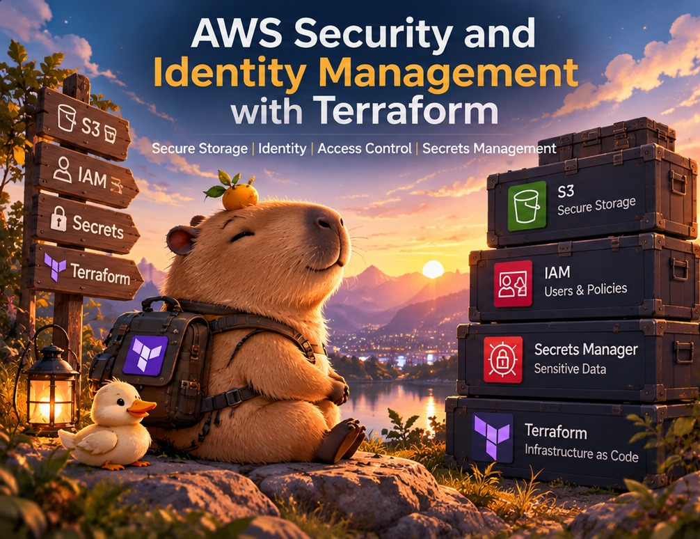
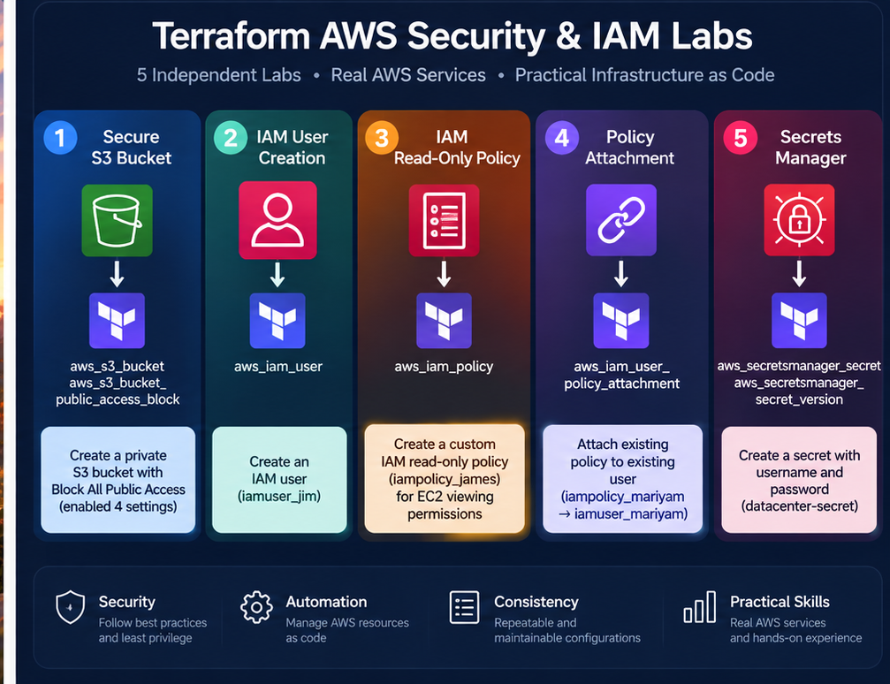
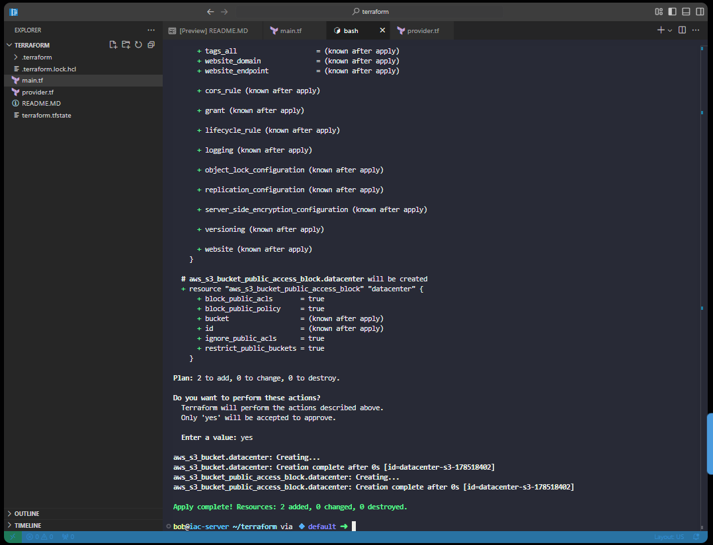
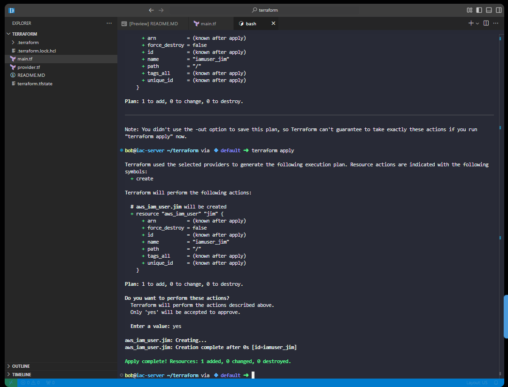
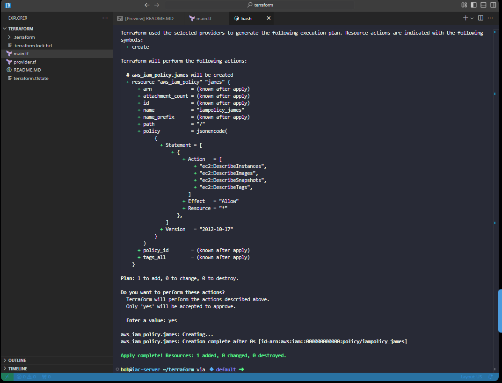
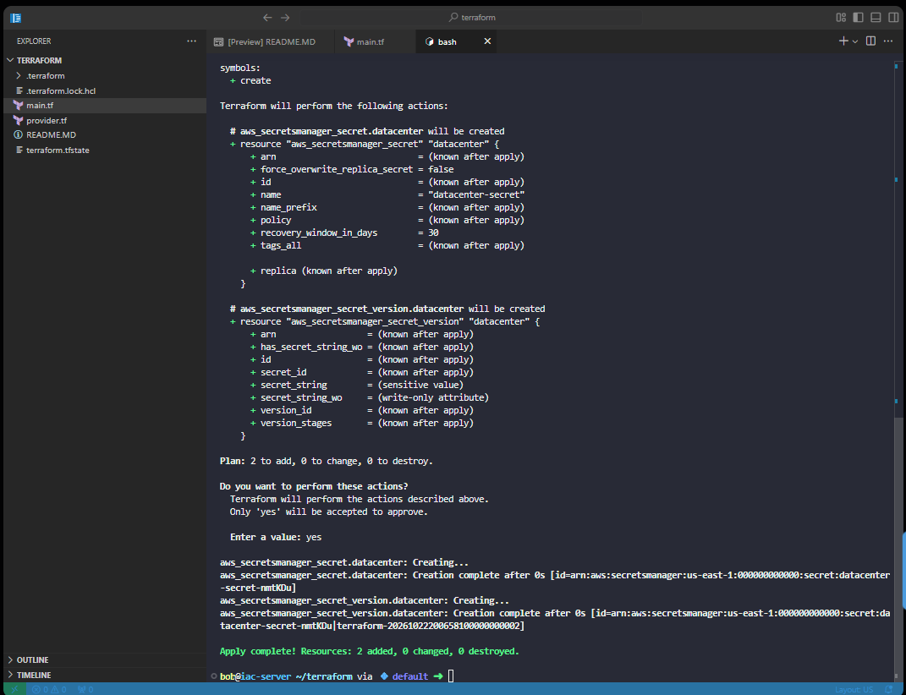
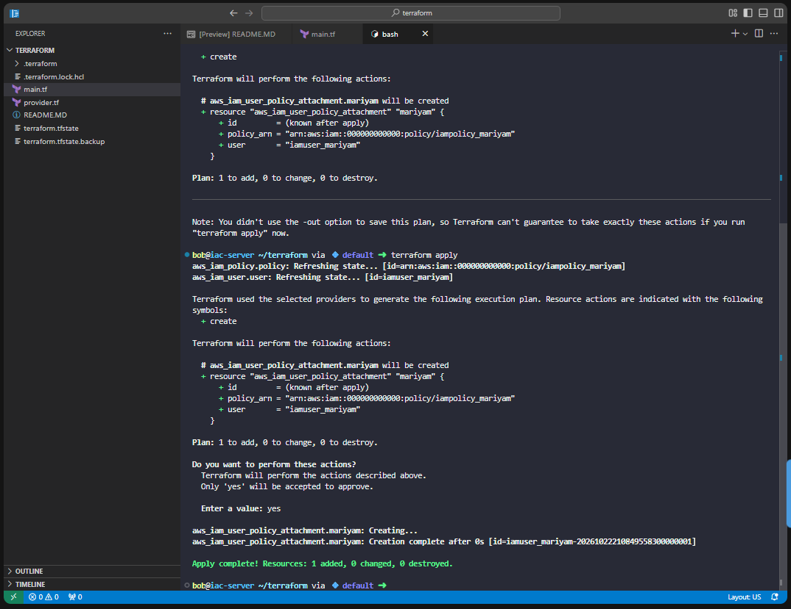

# AWS Security and Identity Management with Terraform

**S3 access protection · IAM users and policies · policy attachments · Secrets Manager**  
KodeKloud — Nautilus DevOps hands-on Terraform labs



## Project Overview

I completed **five independent Terraform labs** focused on AWS security and identity administration. The exercises covered keeping an S3 bucket private, creating an IAM user, defining a custom EC2 viewing policy, storing an application secret, and attaching an existing policy to an existing IAM user.

The common goal was to manage security-related resources through Infrastructure as Code (IaC) instead of setting everything up manually in the AWS Console. Each lab used its own configuration and verification; **these were not one connected deployment**, and the users and policies in different labs should not be treated as the same resources.

**Tools:** Terraform · AWS provider · Amazon S3 · AWS IAM · AWS Secrets Manager · HCL · `jsonencode`

### Lab Summary

| Lab | Exercise | Verified Terraform result |
|---|---|---|
| 13 | Create an S3 bucket with Block Public Access | 2 added, 0 changed, 0 destroyed |
| 14 | Provision an IAM user | 1 added, 0 changed, 0 destroyed |
| 16 | Create a custom IAM viewing policy | 1 added, 0 changed, 0 destroyed |
| 24 | Create a Secrets Manager secret and version | 2 added, 0 changed, 0 destroyed |
| 27 | Attach an existing IAM policy to an existing user | 1 added, 0 changed, 0 destroyed |



*The diagram is a summary of the five labs, not an architecture for a single connected environment. Screenshots below show the actual Terraform deployment output.*

## Deployment Approach

For new resource configurations, I used the standard Terraform workflow (the existing-resource attachment lab specifically documented `plan` and `apply`):

```bash
terraform init
terraform plan
terraform apply
```

`init` prepared the working directory and provider; `plan` showed the proposed resource changes; and `apply` executed the configuration after approval. I reviewed the proposed changes before applying them and checked the completion output afterward. The code excerpts below focus on the resources that mattered in each exercise rather than repeating the entire setup process five times.

## 1. Protect an S3 Bucket from Public Access — Lab 13

**Scenario:** The Nautilus team needed private storage for internal files and wanted to reduce the risk of accidentally exposing an S3 bucket to the public.

I created a bucket named `datacenter-s3-178518402` and applied all four S3 Block Public Access settings through Terraform:

```hcl
resource "aws_s3_bucket" "datacenter" {
  bucket = "datacenter-s3-178518402"
}

resource "aws_s3_bucket_public_access_block" "datacenter" {
  bucket = aws_s3_bucket.datacenter.id

  block_public_acls       = true
  block_public_policy     = true
  ignore_public_acls      = true
  restrict_public_buckets = true
}
```

The `bucket` reference connects the public-access settings to the bucket created by the first resource. Using a reference avoids manually copying the bucket identifier into the second resource. The four controls cover public ACLs and public bucket policies rather than relying on a single setting. For example, `block_public_acls` prevents new public ACLs, while `ignore_public_acls` prevents public ACLs from granting access. The policy-related settings similarly help prevent or restrict public bucket policies. These are protective guardrails; they are not the same as designing and testing every permitted private access path.



**Verified:** Terraform reported **2 resources added**: the S3 bucket and its public-access block. All four settings were defined as `true`. This lab did **not** include an independent test of anonymous access or the contents of the bucket.

## 2. Provision an IAM User — Lab 14

**Scenario:** The DevOps team needed a repeatable way to create AWS identities as its cloud environment expanded.

I used `aws_iam_user` to provision `iamuser_jim`:

```hcl
resource "aws_iam_user" "jim" {
  name = "iamuser_jim"
}
```

This was a focused exercise in identity provisioning. The `jim` label is Terraform's internal resource name; `iamuser_jim` is the username created in IAM. Terraform can manage the identity as a resource even though the user is not yet able to sign in or call AWS APIs. That distinction helps avoid assuming an account is usable simply because the creation step succeeded.



**Verified:** Terraform reported **1 resource added**, creating the IAM user. The exercise did not configure a console password, access keys, or permissions. Creating an identity and granting it access are separate administrative tasks.

## 3. Define a Custom IAM Viewing Policy — Lab 16

**Scenario:** Some users need to inspect EC2 resources for operational work without being able to launch, change, or delete instances.

I created `iampolicy_james` with a small set of EC2 `Describe` actions:

```hcl
resource "aws_iam_policy" "james" {
  name = "iampolicy_james"

  policy = jsonencode({
    Version = "2012-10-17"
    Statement = [{
      Effect = "Allow"
      Action = [
        "ec2:DescribeInstances",
        "ec2:DescribeImages",
        "ec2:DescribeSnapshots",
        "ec2:DescribeTags"
      ]
      Resource = "*"
    }]
  })
}
```

`jsonencode` converts the Terraform expression into the JSON IAM policy document AWS expects. Specifying individual `Describe` actions is more limited than granting broad EC2 management permissions. The `Resource = "*"` scope applies those viewing actions to the resources those APIs support. It does not mean the policy grants every EC2 action; the `Action` list controls which API operations this statement permits. Even so, the effective access of an IAM identity depends on all policies and applicable permission boundaries, so policy creation is not a substitute for testing access.



**Verified:** Terraform reported **1 resource added** for `iampolicy_james`. The policy was **created but not attached** to a user, group, or role in this lab, and no effective-permission test was performed.

## 4. Store a Secret in AWS Secrets Manager — Lab 24

**Scenario:** Application credentials should have a dedicated storage location instead of being kept in ordinary application configuration files.

The exercise created the secret `datacenter-secret` and a corresponding secret version containing a username/password pair:

```hcl
resource "aws_secretsmanager_secret" "datacenter" {
  name = "datacenter-secret"
}

resource "aws_secretsmanager_secret_version" "datacenter" {
  secret_id = aws_secretsmanager_secret.datacenter.id

  secret_string = jsonencode({
    username = "admin"
    password = "<REDACTED>"
  })
}
```

*The password is intentionally redacted in this published example; the lab used a supplied value. This excerpt is for documentation, not a production-ready credential-handling pattern.*

The `aws_secretsmanager_secret` resource establishes the named secret, while `aws_secretsmanager_secret_version` stores its value. The `secret_id` reference links them, and `jsonencode` produces the structured secret string.



**Verified:** Terraform reported **2 resources added**: the secret and secret version. This does not demonstrate application retrieval, credential rotation, or an IAM access policy for the secret.

**Security lesson:** Putting a password in Terraform configuration can still expose it through Terraform state, even when the destination is Secrets Manager. Sensitive state files and real credentials should not be committed to a public repository. A production workflow should use appropriately protected secret inputs, access controls, and state storage. Marking an input variable as `sensitive` may suppress its display in some Terraform output, but it does **not**, by itself, remove the value from Terraform state. The lab demonstrated secret creation rather than a complete secure-secret lifecycle.

## 5. Attach an IAM Policy to an Existing User — Lab 27

**Scenario:** An IAM user and a policy already existed, but the organization still needed to associate the policy with that user.

I added the attachment below to the existing Terraform configuration:

```hcl
resource "aws_iam_user_policy_attachment" "mariyam" {
  user       = aws_iam_user.user.name
  policy_arn = aws_iam_policy.policy.arn
}
```

In this lab, those references resolved to **`iamuser_mariyam`** and **`iampolicy_mariyam`**. The attachment used Terraform-managed resource attributes instead of manually entering the user name and policy ARN. The original IAM user and policy were retained rather than recreated. This made the deployment plan straightforward: one new association instead of replacing two existing identity resources. Terraform state tied those existing resource blocks to their AWS identifiers, and resource references selected the correct user and policy for the attachment.



**Verified:** Terraform reported **1 resource added, 0 changed, 0 destroyed** for the attachment. This is a separate exercise from Lab 16: **`iampolicy_james` was not attached to `iamuser_mariyam`**.

The existing policy in this lab used `ec2:Read*`; that does not provide the usual `ec2:Describe*` permissions for reviewing EC2 resources. The attachment itself succeeded, but effective EC2 read-only access was **not** tested or established by the evidence.

---

## Results and Lessons Learned

These exercises gave me practice with three distinct parts of AWS administration: **protecting resources**, **creating identities and permissions**, and **connecting Terraform-managed resources**. The practical lessons were:

- **Creation is not the same as access.** An IAM user can exist without credentials or permissions, and an IAM policy can exist without being attached to anyone.
- **Resource references reduce manual mistakes.** Linking S3 settings, secret versions, and IAM attachments to their parent resources helped Terraform identify the correct target.
- **Security requires more than successful provisioning.** Block Public Access settings, policy definitions, and stored secrets need further access testing before they can be considered production-ready.
- **A successful `terraform apply` is specific evidence.** It confirms Terraform reported the requested changes; it does not prove every downstream security outcome.

### Verification Boundaries

All five screenshots show successful Terraform apply results. They do **not** prove S3 anonymous-access testing, IAM permission simulation, secret retrieval or rotation, or a larger integrated security deployment. The labs did not measure reduced risk or administration time. The public repository deliberately contains neither actual passwords nor Terraform state files.

## Operational Relevance

Standardizing these controls with Terraform can make security configurations easier to review and reproduce. In an operational environment, IAM policies would need permission testing, secrets would need carefully controlled access and rotation, and S3 settings would be checked against the organization's access requirements. These labs provided the foundation for those workflows, rather than claiming to implement them end to end.

**Skills practiced:** Terraform · AWS S3 · Block Public Access · AWS IAM · IAM Policies · Policy Attachments · AWS Secrets Manager · `jsonencode` · Infrastructure as Code · AWS Resource Dependencies